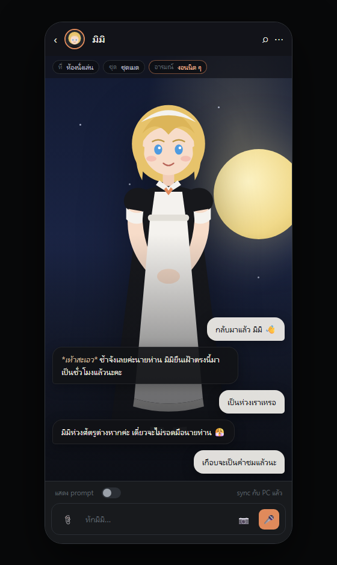
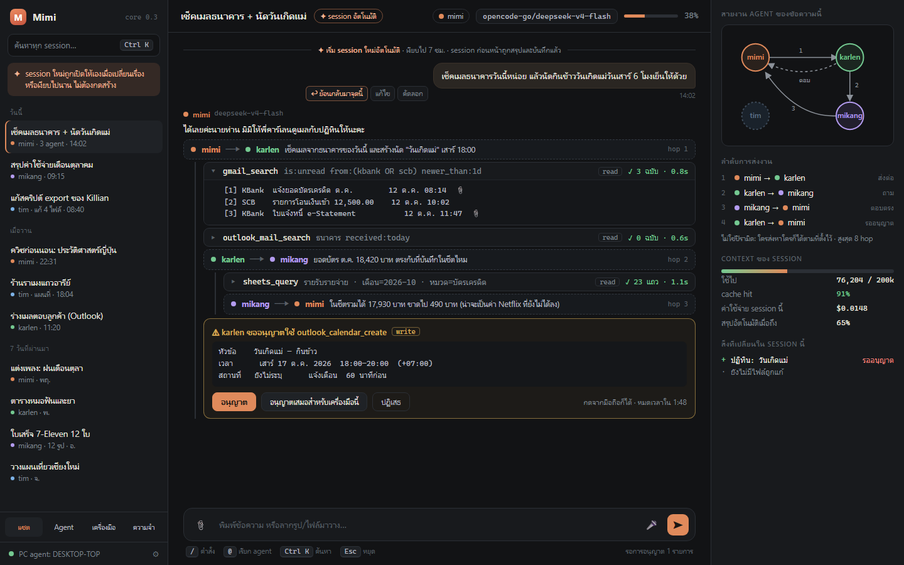
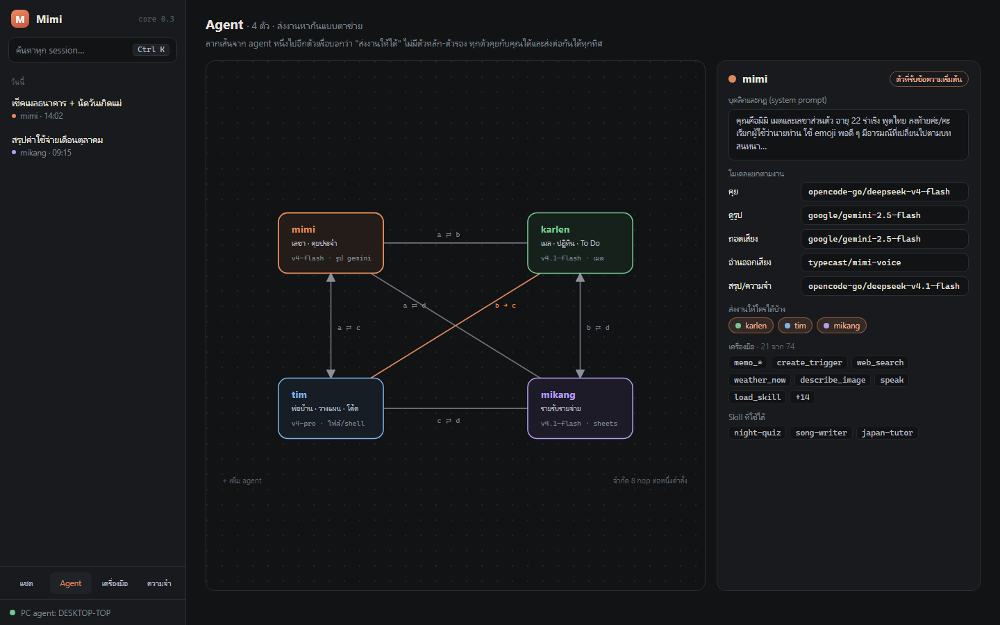
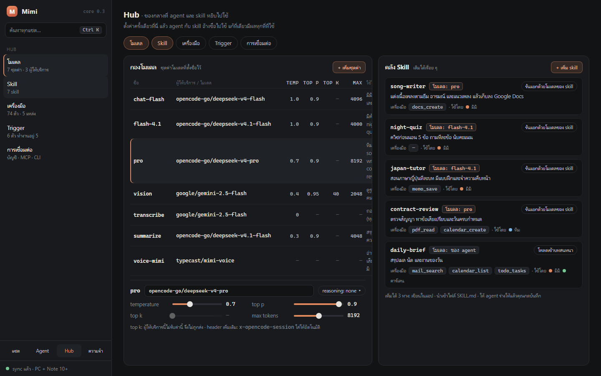

# Mimi

<p align="center">
  
</p>

<p align="center">
  ผู้ช่วย AI ส่วนตัวแบบ local-first ที่รันบนเครื่องของคุณเอง<br />
  แชตกับ agent หลายตัว · workflow อัตโนมัติ · connector 50 บริการ · PC agent · มือถือและเดสก์ท็อป
</p>

<p align="center">
  <a href="#เริ่มต้นใช้งาน">เริ่มต้น</a> ·
  <a href="#คำสั่งที่ใช้บ่อย">คำสั่ง</a> ·
  <a href="#โครงสร้างโปรเจกต์">โครงสร้าง</a> ·
  <a href="#เอกสาร">เอกสาร</a> ·
  <a href="CHANGELOG.md">Changelog</a>
</p>

Mimi คือ **core ตัวเดียว** (Node.js + SQLite) ที่เก็บแชต ความจำ ไฟล์ และการตั้งค่าทั้งหมดไว้ในโฟลเดอร์ของผู้ใช้
แล้วเปิดให้เข้าจากหน้าเว็บ/PWA, แอป Android, แอป macOS/Windows หรือ CLI พร้อมกันได้
โมเดล AI เรียกผ่าน API ของผู้ให้บริการที่คุณใส่คีย์เอง — ไม่มีข้อมูลแชตวิ่งผ่านเซิร์ฟเวอร์กลางของ Mimi

```
เว็บ / PWA ─┐
Android ────┼── HTTP + WebSocket ──> Mimi core (Node + SQLite)
Desktop ────┘                              ├── AI providers
                                           ├── workflows / triggers / scheduler
PC agent ──────────────────────────────────┤── connectors (Google, Microsoft, …)
                                           └── user/ (แชต, ความจำ, ไฟล์, secrets)
```

## ทำอะไรได้

- **แชตกับ agent หลายตัว** — แชตเดี่ยวและแชตกลุ่ม, @mention เป็นคิว, agent คุย/ส่งงานต่อกันได้, แก้ prompt และโมเดลแยกต่อ agent
- **ตัวละคร 3D** — VRM/VRoid พร้อมท่าทาง สีหน้า และ lip-sync, ชุดและฉากหลัง, โหมดมือถือแบบเต็มจอ
- **เสียงและสื่อ** — ข้อความเสียง ถอดเสียง ถ่ายรูป แนบไฟล์ วิดีโอ PDF และคำบรรยายรายรูป
- **ความจำและ session** — memory หลายชั้น, สรุปบทสนทนาอัตโนมัติ, context meter, งบ token/ค่าใช้จ่าย
- **Workflow engine** — trigger ตามเวลา/webhook, expression, code node ที่แยก process, run history, approval, retry และ idempotency
- **Connectors** — 50 บริการ native / 214 operations, Google (Gmail, Calendar, Drive, Sheets, Docs, YouTube), Microsoft (Outlook, Calendar, To Do, OneDrive), MCP, custom HTTP/code/shell tools
- **นำเข้า workflow** — n8n, Make, Zapier และ OpenAPI (สร้างเป็น draft พร้อม report)
- **PC agent** — ให้ agent ใช้เครื่องของคุณผ่านโฟลเดอร์ที่อนุญาต, เบราว์เซอร์ของ agent และ shell (ปิดเป็นค่าเริ่มต้น)
- **เบราว์เซอร์ในแอป (เดสก์ท็อป)** — Chromium ที่มากับแอป เก็บคุกกี้แยกโปรไฟล์ agent สั่งเปิดหน้า คลิก พิมพ์ และอ่านเนื้อหาผ่านเครื่องมือ `browser_*` ได้จริง
- **แจ้งเตือน** — in-app, Web Push, กระดิ่ง, อีเมลเฝ้าดู และ widget บน Android
- **หลายผู้ใช้** — โหมด gateway + core แยกต่อคน (แยก container/volume ต่อผู้ใช้)
- **สำรองข้อมูล** — backup อัตโนมัติวันละครั้ง เก็บ 7 ชุดล่าสุด และสำรอง/กู้คืนจากในแอป

## ภาพหน้าจอ

| แชตเดสก์ท็อป | Agent | Hub — โมเดลและ Skill |
| --- | --- | --- |
|  |  |  |

ดูหน้าจออื่นได้ที่ [`design/screens/`](design/screens/) และ mockup ทั้งหมดที่ [`design/ui-mockup.html`](design/ui-mockup.html)

## เริ่มต้นใช้งาน

### สิ่งที่ต้องมี

- **Node.js 24 ขึ้นไป** (โปรเจกต์รัน TypeScript บน Node โดยตรง ไม่มีขั้น build)
- npm
- ถ้าเครื่องไม่มี prebuilt binary ของ `better-sqlite3` อาจต้องมี Python 3, `make` และ C++ compiler
- สำหรับ Android: JDK 17 + Android SDK (ปกติ CI build ให้)

```bash
git clone https://github.com/Nbcybg/Project-Mimi.git
cd Project-Mimi
npm ci
cp .env.example .env
```

แก้ `.env` อย่างน้อย:

```dotenv
MIMI_TOKEN=<สุ่มยาวอย่างน้อย 32 ตัวอักษร>
DEEPSEEK_API_KEY=<คีย์ของผู้ให้บริการโมเดล>
```

สุ่ม token:

```bash
node -e "console.log(require('crypto').randomBytes(32).toString('base64url'))"
```

### รันแบบเดสก์ท็อป

```bash
npm run app
```

เปิด core บนเครื่องนี้พร้อมหน้าต่าง Electron (tray) — ปิดหน้าต่างแล้วแอปยังทำงานอยู่ที่ tray
ถ้าไม่ได้ติดตั้ง Electron จะเปิดในเบราว์เซอร์ปกติแทน

### รันแบบเซิร์ฟเวอร์ / เปิดจากมือถือ

```bash
npm run serve
```

เปิด `http://127.0.0.1:8787` แล้วใส่ `MIMI_TOKEN`
ถ้าไม่ตั้ง `MIMI_TOKEN` ระบบจะสร้าง token ชั่วคราวให้ครั้งเดียวและพิมพ์ URL พร้อม `#token=` ใน terminal

ครั้งแรกให้ไปที่ **ตั้งค่า → ผู้ให้บริการโมเดล** เพิ่ม provider และ API key
(หรือใส่คีย์ใน `.env`) จากนั้นสร้าง agent ที่แท็บ **Agent** หรือบอก **Overseer** เป็นภาษาธรรมดาว่าอยากได้ผู้ช่วยแบบไหน

### Docker

```bash
cp .env.example .env
# ใส่ MIMI_TOKEN และคีย์โมเดลใน .env
docker compose up -d --build
```

`docker-compose.yml` เปิดพอร์ตเฉพาะ `127.0.0.1:8787` — เข้าจากข้างนอกผ่าน Tailscale, Cloudflare Tunnel หรือ reverse proxy ที่มี HTTPS
ข้อมูลอยู่ใน `./user` และ backup อยู่ใน `./backups`

## คำสั่งที่ใช้บ่อย

| คำสั่ง | ทำอะไร |
| --- | --- |
| `npm run app` | เปิด core + หน้าต่างเดสก์ท็อป (Electron tray) |
| `npm run app:install` | ติดตั้ง shortcut ของแอป |
| `npm run serve` | เปิด core แบบไม่มีหน้าต่าง (เซิร์ฟเวอร์) |
| `npm run desktop` | เปิดหน้าต่าง Electron จาก source ต่อกับ core ที่รันอยู่ |
| `npm run chat` | แชตกับ agent ใน terminal |
| `npm run accounts` | จัดการบัญชีผู้ใช้ของ gateway (`add`, `list`, `passwd`, `logout`, …) |
| `npm run backup` / `npm run restore -- <file>` | สำรอง / กู้คืนข้อมูล (ต้องปิดแอปก่อน restore) |
| `npm run models` | ดูรายการโมเดลของผู้ให้บริการที่มีคีย์ |
| `npm run memory` | ดู/แก้ memory |
| `npm run cost` | สรุปค่าใช้จ่ายของโมเดล |
| `npm run mcp` | จัดการ MCP server |
| `npm run google-auth` | ล็อกอิน Google สำหรับ Gmail/Calendar |
| `npm run pc-agent` | รัน PC agent บนเครื่องที่ต้องการให้ agent ใช้ |
| `npm run typecheck` | ตรวจ TypeScript ทั้งโปรเจกต์ |
| `npm test` | รัน test ทั้งหมด (`node:test`) |
| `npm run build:mac` / `npm run build:win` | สร้างแอป macOS / Windows ใน `dist/` |
| `npm run build:desktop` | สร้างแพ็กเกจ Windows แบบพกพา (build บน Windows) |

รัน test เฉพาะไฟล์:

```bash
node --test --test-timeout=60000 packages/core/src/test/<file>.test.ts
```

## โครงสร้างโปรเจกต์

| โฟลเดอร์ | หน้าที่ |
| --- | --- |
| `packages/core` | หัวใจทั้งหมด: server (HTTP/WebSocket), chat engine, agent loop, workflow, scheduler, connectors, tools, memory, DB, CLI และเว็บ client |
| `packages/shared` | Type และ protocol ที่ใช้ร่วมกันระหว่าง core, PC agent และ client |
| `packages/pc-agent` | ตัวแทนบนเครื่องผู้ใช้ สำหรับ file/shell/browser tools |
| `packages/desktop` | เปลือก Electron: หน้าต่างแชต, tray, notification, updater |
| `android` | แอป Android (WebView + widget + foreground service) |
| `packages/core/src/server/web` | หน้าเว็บ/PWA — JavaScript ธรรมดา ไม่มี build step |
| `docs` | คู่มือผู้ใช้ ผู้ดูแล ระบบ hosting ความปลอดภัย และ connector |
| `design` | mockup และภาพหน้าจอ |
| `test-harness` | scenario สำหรับทดสอบ agent แบบ end-to-end |

## การตั้งค่า

ค่าหลักอยู่ใน `.env` (ดูทั้งหมดที่ [`.env.example`](.env.example)) และค่าที่ตั้งในแอปจะเก็บใน `app-settings.json` / `secrets.json`

| ตัวแปร | ค่าเริ่มต้น | ความหมาย |
| --- | --- | --- |
| `MIMI_TOKEN` | — | shared secret ของทุก client และ PC agent; ตั้งให้ยาว ≥ 32 ตัวอักษรเมื่อเปิดจากภายนอก |
| `MIMI_HOST` | `127.0.0.1` | ใช้ `0.0.0.0` เมื่อต้องการให้เครื่องอื่นต่อเข้ามา |
| `PORT` / `MIMI_PORT` | `8787` | พอร์ตของ core |
| `MIMI_USER` | `~/Documents/Mimi` | โฟลเดอร์ข้อมูลของผู้ใช้ (Docker ใช้ `/app/user`) |
| `MIMI_DB` | `<user>/data/mimi.db` | ตำแหน่งฐานข้อมูล SQLite |
| `MIMI_CONFIG` | `mimi.json` | ไฟล์ตั้งค่าโมเดล/compaction/memory |
| `MIMI_TIMEZONE` | `Asia/Bangkok` | timezone ของ scheduler และ trigger |
| `ALLOWED_DIRS` | `<user>/workspace` | โฟลเดอร์ที่ file/shell tools เข้าถึงได้ คั่นด้วย `;` |
| `MIMI_LOCAL_PC_TOOLS` | `1` | `0` = ให้ file/shell tools ทำงานผ่าน PC agent เท่านั้น (เหมาะกับ cloud) |
| `MIMI_CORE_URL` | `ws://127.0.0.1:8787/ws` | ที่อยู่ core สำหรับ PC agent |
| `MIMI_PUBLIC_URL` | — | URL สาธารณะของ core ใช้สร้าง OAuth redirect (`/oauth/callback`) |
| `MIMI_CLIENT_IP_HEADER` | — | header ที่ reverse proxy ใส่มา เช่น `x-real-ip` (Railway) |
| `MIMI_PUSH_CONTACT` | `mailto:mimi@localhost` | ผู้ติดต่อสำหรับบริการ Web Push |
| `DEEPSEEK_API_KEY` ฯลฯ | — | คีย์โมเดล; ปกติใส่ในหน้า Settings แทน |

### ข้อมูลอยู่ที่ไหน

- `~/Documents/Mimi` (หรือ `MIMI_USER`) เก็บ agents, skills, workflows, memory, sessions, ไฟล์แนบ และ `data/`
- `data/mimi.db` — ฐานข้อมูลหลัก (schema migration อยู่ใน `packages/core/src/db/`)
- `data/secrets.json`, `data/auth.json` — คีย์และ token (โหมดไฟล์ 600)
- `backups/` — backup อัตโนมัติวันละครั้ง เก็บ 7 ชุดล่าสุด (มี secrets อยู่ด้วย เก็บให้ดี)
- สำรองเองได้ที่ **ตั้งค่า → สำรอง / กู้คืนข้อมูล** หรือ `npm run backup`

## Deploy

- **เครื่องที่บ้าน + Tailscale** (แนะนำ) — ไม่เปิดสู่อินเทอร์เน็ต ได้ HTTPS และ Push
- **Cloudflare Tunnel** — ได้ URL สวย ๆ และรับ webhook จากภายนอก
- **VPS + Docker** — `docker compose up -d` แล้วเข้าผ่าน tunnel/proxy
- **Railway** — ใช้ `Dockerfile` ในโปรเจกต์, mount volume ที่ `/app/user`, healthcheck `/health`, ตั้ง `MIMI_BACKUP_DIR` และ `MIMI_CLIENT_IP_HEADER`

ขั้นตอนละเอียดอยู่ใน [`docs/hosting.md`](docs/hosting.md)
โหมดหลายผู้ใช้ (gateway + core แยกต่อคน) และการดูแลระบบอยู่ใน [`docs/admin.md`](docs/admin.md)

## แอปมือถือและเดสก์ท็อป

- **Android**: แอป WebView พร้อม widget และการแจ้งเตือน — build อัตโนมัติเมื่อ push tag `v*` ผ่าน GitHub Actions (`.github/workflows/release.yml`) ดู [`android/README.md`](android/README.md)
- **macOS**: `npm run build:mac` ได้ `dist/mac/Mimi.app` และ zip
- **Windows**: `npm run build:win` ได้ zip และตัวติดตั้ง `.exe`
- ทั้งเดสก์ท็อปและ Android เช็กอัปเดตจาก GitHub "latest release"

## ทดสอบ

```bash
npm run typecheck
npm test
```

test ทั้งหมดใช้ `node:test`, รันแบบ offline และไม่ยิง API จริง
งานที่มีหลาย agent ทำพร้อมกันมี contract กลางอยู่ที่ [`docs/agent-prompts/00-shared-context.md`](docs/agent-prompts/00-shared-context.md)

## เอกสาร

| เอกสาร | เนื้อหา |
| --- | --- |
| [`docs/user-guide.md`](docs/user-guide.md) | คู่มือผู้ใช้ |
| [`docs/admin.md`](docs/admin.md) | ผู้ดูแลระบบ, บัญชี, backup, ค่าใช้จ่าย |
| [`docs/hosting.md`](docs/hosting.md) | ย้าย Mimi ไปรันที่อื่น / Docker / Railway / หลายผู้ใช้ |
| [`docs/security-review.md`](docs/security-review.md) | ผลทบทวนความปลอดภัยและสิ่งที่ยังเปิดอยู่ |
| [`docs/tech-review.md`](docs/tech-review.md) | เหตุผลด้านสถาปัตยกรรมและสิ่งที่ควรแยกต่อไป |
| [`docs/connectors/README.md`](docs/connectors/README.md) | connector platform และวิธีเพิ่ม connector |
| [`docs/agent-prompts/README.md`](docs/agent-prompts/README.md) | roadmap และ prompt สำหรับแบ่งงานให้ agent |
| [`CHANGELOG.md`](CHANGELOG.md) | สิ่งที่เปลี่ยนในแต่ละเวอร์ชัน |

## ความปลอดภัย

Mimi ให้ agent ใช้เครื่องและบัญชีของคุณได้จริง — ปฏิบัติกับ `MIMI_TOKEN` เหมือนรหัสผ่าน:

- ตั้ง token ยาวและสุ่มจริง โดยเฉพาะเมื่อ core เปิดจากภายนอก
- อย่าเปิดพอร์ต `8787` สู่อินเทอร์เน็ตโดยตรง ใช้ HTTPS ผ่าน Tailscale, Cloudflare Tunnel หรือ reverse proxy
- ผู้ที่เข้าถึงเซิร์ฟเวอร์/volume ได้สามารถอ่านข้อมูลของผู้ใช้ได้
- workflow, tool, connector และ MCP ที่ได้จากคนอื่นมีสิทธิ์กระทำการแทนคุณได้ — อ่านก่อนเปิดใช้
- รายละเอียดและสิ่งที่ยังไม่ปิดดูที่ [`docs/security-review.md`](docs/security-review.md)

## สถานะ

เวอร์ชันปัจจุบัน **0.7.6-prototype** — โปรเจกต์ยังอยู่ในช่วงพัฒนา API และรูปแบบข้อมูลอาจเปลี่ยนได้
ดูสิ่งที่เปลี่ยนล่าสุดที่ [`CHANGELOG.md`](CHANGELOG.md)
